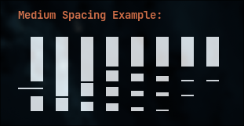

# Ideas / possible future additions

Nothing here is planned or promised — it's a parking lot.

## Decay / bar patterns

The screenshot above is a bar-decay pattern that was an early reference: bars
that shed negative space as they fall (Fibonacci-spaced gaps, more toward the
top) so a bar visibly disintegrates rather than sliding down. An earlier
`fibonacci` bar style chased this and was scrapped for being fiddly at the
gain levels the AGC produces; it could come back as an opt-in style now that
the amplitude curve is separated out.

## Platforms

Windows and macOS support will be considered. The TUI (Bubble Tea) is
already cross-platform; the Linux-only part is the audio capture, which
binds libpulse via cgo to record the default sink's monitor source. Ports
would need a native loopback backend behind the same `Capturer` interface:

- **Windows** — WASAPI loopback capture.
- **macOS** — CoreAudio, via a system loopback device (e.g. BlackHole /
  an aggregate device) or a ScreenCaptureKit audio tap on recent versions.

A non-PulseAudio backend on Linux too (PipeWire native, JACK, or a plain
file / pipe input) would drop the cgo dependency and let it run headless.

## Other

- Now-playing line — done 2026-10-05 as the `t` title modes (`app` draws it
  at the top; `nowplaying/` + `title/`). Still open: MPD's `currentsong` as a
  source, and a native D-Bus watcher instead of playerctl.
- Beat detection → a pulse/flash on the whole frame or the colour ramp.
- More colour schemes (vaporwave, amber-CRT, mono-green).
- Per-band gain trim, not just a global multiplier.
- A frequency-label ruler along the bottom in `vertical`.
- Record mode (write frames to an animated image / video).
- Toggle for cava-style attack/decay — switch the temporal smoother between
  the current cli-visualizer envelope (`SMOOTHING_ALPHA` attack +
  `BAR_FALLOFF_WEIGHT` release, `viz/smooth.go`) and cava's (gravity
  falloff + integral / noise-reduction smoothing). Flag + live key.
- Stereo layout along the horizontal axis — bars rise like `vertical`, but
  the width splits into L and R halves (e.g. mirrored, lows at the centre or
  at the edges). Reuses butterfly's stereo capture + `NormalizeShared`;
  `wantsStereo()` must cover it.
- Configurable splash still (point `-splash-image` at a file instead of the
  embedded one).
